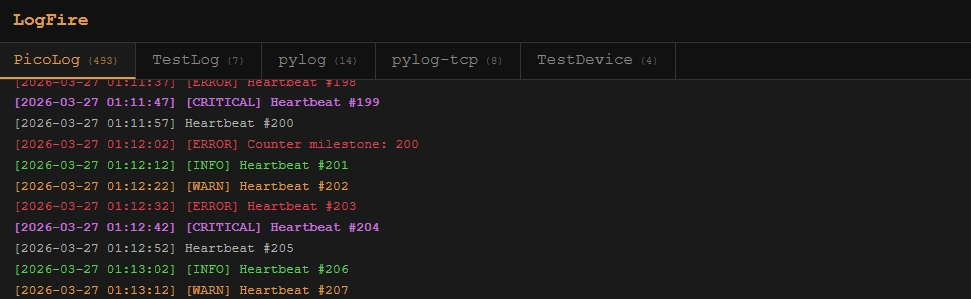

# LogFire

A small debug logging setup I put together for WiFi microcontroller projects. When the device is wireless or across the room, `log()` sends the message over HTTP to a Node-RED hub — you can watch it live in the browser. Serial output is mirrored by default so the existing workflow stays intact. Libraries for Arduino (ESP8266/ESP32) and MicroPython (Pico W).



---

## How it works

```text
[Your Device]  →  HTTP POST or UDP plain text  →  [Node-RED Hub]  →  WebSocket  →  [Browser UI]
```

The library formats each message automatically before sending:

```text
DEVICENAME: your message here
DEVICENAME(-2): something to warn about
```

The device name and log level are added by the library — you only pass the message string and an optional level integer to `log()`.

| Level | Name | Color |
| --- | --- | --- |
| 0 | *(plain)* | white |
| 1 | INFO | green |
| 2 | WARN | yellow |
| 3 | ERROR | red |
| 4 | CRITICAL | purple |

Node-RED receives it, parses the device name and level, timestamps it, and stores it in memory. Logs can be observed live at `http://<node-red-host>:1880/logfire`. Per-device logs are capped at 3 MB — oldest entries are evicted as soon as the limit is reached. Messages may span several lines (for example stack traces). The browser UI shows a live tab per device with a filter dropdown.
To keep large histories responsive, each browser tab renders the latest 2,000
retained entries while preserving the complete retained count.
Device count is not capped: the 3 MB limit applies to each device's retained
logs, not to total hub memory.

---

## Transport status

| Transport | Node-RED hub | Bundled clients | Status |
| --- | --- | --- | --- |
| HTTP over TCP | Yes, `POST /log` | `LogFire` (Arduino), `logfire.py` (MicroPython) | Supported |
| UDP | Yes, input on UDP port 1880 | `LogFireUDP` (Arduino), `logfire_udp.py` (MicroPython) | Experimental |

Both transports use the same message format, parser and storage path. UDP sends
without waiting for a hub response; packets can be lost, duplicated or reordered.
DNS lookup and socket operations can still take time. HTTP waits for the hub's
response. If a send fails on a reused connection, the HTTP clients reconnect
and send the message once more (a duplicate is possible); beyond
that, neither client queues failed messages, so neither transport guarantees
delivery. Compilation and desktop tests do not establish delivery on physical
ESP32, ESP8266 or Pico boards. Client network behavior still needs hardware
validation; UDP remains experimental.

---

## Quick start

> For a step-by-step guide see [HOWTO.md](HOWTO.md).

### 1. Hub (Node-RED)

Run `python nodered/build.py` to embed the UI and maintained Function-node
sources into the flow, then import `nodered/flow.json` into Node-RED. The flow
serves the UI at `GET /logfire`.

The hub periodically saves logs to `/data/logfire_logs.json`. Keep `/data` on a
persistent volume to retain saved logs when recreating the container. An
unexpected stop can lose changes since the last successful save; an HTTP
response does not confirm a disk write. See [HOWTO.md](HOWTO.md) for setup and
delivery limitations.

### 2. Arduino (ESP32 / ESP8266)

Copy `arduino/LogFire/` into your project's `lib/` directory.

```cpp
#include <LogFire.h>

LogFire.begin("MyDevice", "192.168.1.100", 1880);

LogFire.log("Device booted");              // level 0 (plain)
LogFire.log("Sensor timeout", 2);          // level 2 (WARN)
// LogFire.mirrorSerial(false);            // disable Serial echo (on by default)
// LogFire.localOnly(true);               // Serial only, no network
```

**UDP** — fire and forget, without waiting for a hub response:

```cpp
#include <LogFireUDP.h>

LogFireUDP.begin("MyDevice", "192.168.1.100", 1880);

LogFireUDP.log("Device booted");
LogFireUDP.log("Sensor timeout", 2);
// LogFireUDP.mirrorSerial(false);
// LogFireUDP.localOnly(true);
```

See [`arduino/LogFire/examples/`](arduino/LogFire/examples/) for full examples (TCP and UDP).

### 3. MicroPython (Pico W / Pico W2)

Copy `micropython/logfire.py` to your Pico W:

```python
import logfire

logfire.init("MyPico", "192.168.1.100", 1880)

logfire.log("Device booted")               # level 0 (plain)
logfire.log("Sensor timeout", 2)           # level 2 (WARN)
# logfire.mirror_serial(False)             # disable print echo (on by default)
# logfire.local_only(True)                 # Serial only, no network
```

**UDP** — copy `micropython/logfire_udp.py` to your Pico W:

```python
import logfire_udp

logfire_udp.init("MyPico", "192.168.1.100", 1880)

logfire_udp.log("Device booted")
logfire_udp.log("Sensor timeout", 2)
# logfire_udp.mirror_serial(False)
# logfire_udp.local_only(True)
```

See [`micropython/example/main.py`](micropython/example/main.py) (TCP) and
[`micropython/example/main_udp.py`](micropython/example/main_udp.py) (UDP) for full examples.

---

## Network scope and security

LogFire is intended for a private, trusted local network. Its HTTP, WebSocket,
and UDP interfaces have no authentication or encryption. Do not expose Node-RED
port `1880` to the public internet, configure router port forwarding for it, or
place it on an untrusted network.

When Node-RED runs in Docker, bind published ports to the host's LAN address and
restrict access to the local subnet with the host firewall. UDP packets can be
forged, lost, duplicated, or reordered, so UDP remains appropriate only for
best-effort debug logs.

---

## Requirements

- **Hub:** Node-RED (any machine on your local network)
- **Arduino:** ESP8266 or ESP32 with WiFi connected
- **MicroPython:** Raspberry Pi Pico W or Pico W2

---

## License

MIT
